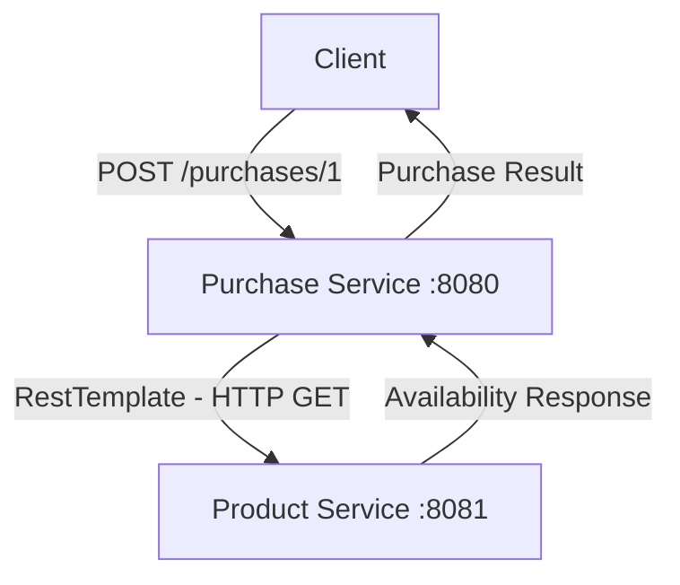

# Microservices Demo

A hands-on project exploring **Microservices Architecture** using Java and Spring Boot. Two independent services communicate through synchronous HTTP requests.

## Architecture



## Services

| Service | Port | Responsibility |
|---|---:|---|
| Product Service | 8081 | Checks product availability |
| Purchase Service | 8080 | Processes purchases by calling Product Service |

## Tech Stack

- Java 25
- Spring Boot 4.1.1
- Spring Web
- RestTemplate
- Maven

## Project Structure

```text
MicroServices-Demo/
├── product-service/
└── purchase-service/
```

Each service is an independent Spring Boot Maven project.

## Run Locally

Start Product Service:

```bash
cd product-service
mvn spring-boot:run
```

Start Purchase Service in another terminal:

```bash
cd purchase-service
mvn spring-boot:run
```

Both services must be running simultaneously.

## API Testing

**Check product availability**

```http
GET http://localhost:8081/products/1
```

**Make a purchase**

```http
POST http://localhost:8080/purchases/1
```

Try product ID `2` to test the unavailable-product response.

## What I Learned

- Building independent Spring Boot services.
- REST API communication between microservices.
- Using `RestTemplate` for synchronous HTTP calls.
- Dependency Injection and service-layer design.
- Managing multiple Maven projects in one Git repository (Monorepo).

## Future Improvements

- Database integration
- Service Discovery (Eureka)
- API Gateway
- Fault Tolerance (Resilience4j)
- Docker
- Asynchronous communication (Kafka)

---

<p align="center">
  Built while learning Java, Spring Boot and Microservices.
</p>